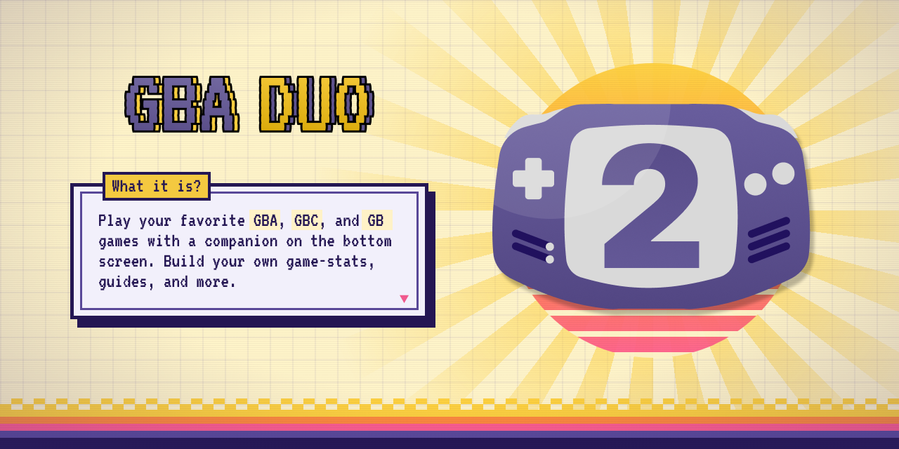

<div align="center">



<h3>Play on the top screen. Your game's stats, guides and more on the bottom one.</h3>

<p>
  <a href="https://github.com/khumam/gba-duo/releases/latest"></a>
  <a href="https://github.com/khumam/gba-duo/releases"></a>
</p>

<p>
  <strong><a href="https://github.com/khumam/gba-duo/releases/latest">Download</a></strong>
  · <strong><a href="#features">Features</a></strong>
  · <strong><a href="#companion-packs">Companion packs</a></strong>
  · <strong><a href="#make-your-own-pack">Make your own pack</a></strong>
  · <strong><a href="https://github.com/khumam/gba-duo/issues">Report a problem</a></strong>
</p>

</div>

GBADuo is a Game Boy Advance, Game Boy Color and Game Boy player for dual-screen
Android handhelds. The game runs on the screen you open it on (usually the top
one), and the other screen is a **companion**: a screen built from a pack that reads your game's memory as you
play and shows what matters, like your party and bag in Pokémon FireRed or your
rucksack and friendships in Harvest Moon. Packs are plain files (a layout, CSS and
a Lua script), so anyone can build one for their favorite game.

## Devices

| Device    | Status                                                                     |
| --------- | -------------------------------------------------------------------------- |
| AYN Thor  | Tested, made for it                                                        |
| Others    | Should run on any dual-screen Android 11+ device (arm64), not yet tested   |

The companion needs a second screen. Open GBADuo on either screen: the game
plays there and the companion takes the other one.

## Install

1. Download `gbaduo-<version>.apk` from the
   [latest release](https://github.com/khumam/gba-duo/releases/latest) on the device.
2. Open it. If Android asks, allow your browser or file manager to install apps.
3. Open GBADuo and tap **+** to add a ROM folder. Every `.gba`, `.gbc` and `.gb`
   file in it shows up in your library. You can add more folders, or remove
   one, under **ROM folders**; removing a folder never deletes its files.

**No games are included.** Use your own legally dumped ROMs.

<details>
<summary><strong>Updates</strong></summary>

GBADuo doesn't check for updates. Download the newer APK from the
[releases page](https://github.com/khumam/gba-duo/releases) and install it over
the old one; your saves stay.

</details>

## Features

### The companion (bottom screen)

- **Packs per game** - tap **⋮** next to a game in your library to choose its
  companion pack, or **Import pack…** to add one from a `.zip`. Each game remembers
  its own pack.
- **Live** - the pack's Lua script reads the game's memory several times a second,
  so the screen follows along as you play.
- **Touch** - tabs, buttons and pages you can tap through; the controller keeps
  driving the game whichever screen has focus.
- **Pages that open by themselves** - a pack can switch pages when something happens
  in the game, like FireRed's battle page opening when a battle starts and closing
  when it ends.

### The player (top screen)

- **Save states** - 9 slots per game, each showing when it was saved.
- **In-game saves** - kept per game, next to its save states.
- **Save folder** - optionally mirror every game's saves to a folder you pick (SD
  card, a synced folder), so backups and moving to another device are file copies.
- **Fast-forward** - hold **R2**; 2x, 3x or 4x, picked in the menu.
- **Shaders** - Off, GBA Color, LCD Grid, Scanlines and Scale2x.
- **Swap A/B** - flips the A and B buttons if they feel the wrong way round.

Press **L2** or **BACK** in a game for the menu: resume, save state, load state,
fast-forward speed, shader, swap A/B and quit.

### Your saves

Each game has its own folder, named by platform and ROM checksum, so it follows the
game wherever the ROM file is:

```
<platform>/<Title> [<code>-<CRC32>]/
    game.sav          the game's own save
    states/slotN.ss   save states
    pack.json         the companion pack picked for it
```

They live in the app's private storage. **Settings > Save folder** keeps a copy of
all of them in a folder you choose with the system folder picker:

- Games still play from the private copy. It's copied to the folder after each in-game
  save and save state, on pause and on quit, and newer saves already in the folder
  (from another device) are taken in when a game starts.
- The first time, every save is copied over and checked before the folder is used.
- If a save changed in both places, the newer one is kept and the other is saved next
  to it as `game.sav.conflict-<time>`. Nothing is overwritten silently.
- If the folder can't be reached (SD card out), the game plays from the private copy
  and the folder catches up once it's back.
- Companion packs and the ROM list stay private.

To back up, copy the folder. To move to another device, copy it there and pick it as
the save folder: each game finds its saves by checksum, whatever the file is called.

### Controls

| Thor        | Game              |
| ----------- | ----------------- |
| D-pad       | D-pad             |
| A / B       | A / B (Swap A/B flips them) |
| L1 / R1     | L / R             |
| Start       | Start             |
| Select      | Select            |
| R2 (hold)   | Fast-forward      |
| L2 / BACK   | Menu              |

## Companion packs

Packs live in their own repo,
[gba-duo-companions](https://github.com/khumam/gba-duo-companions). Download a
pack's `.zip` from its [releases](https://github.com/khumam/gba-duo-companions/releases)
and add it with **⋮ > Import pack…**.

| Game                                         | Pack                          | Shows                                                                                       |
| -------------------------------------------- | ----------------------------- | ------------------------------------------------------------------------------------------- |
| Pokémon FireRed (US)                         | `pokemon-firered-companion`   | Party, bag pockets, trainer card, and a battle page with both Pokémon's live stats          |
| Harvest Moon: Friends of Mineral Town (EU/US) | `harvest-moon-fomt-companion` | Gold, date and time, stamina, held tool and rucksack, affection, Harvest Sprites' work      |

Want a pack for another game? [Open an issue](https://github.com/khumam/gba-duo/issues),
or make one.

## Make your own pack

A pack is a folder with:

- `manifest.json` - its id, name and which games it's for (game code or CRC32);
- `layout.json` - the screen: boxes, text, images, bars, lists, tabs and pages;
- `style.css` - real CSS: flex and grid layout, colors, borders, shadows, fonts and transitions;
- `main.lua` - an `update()` that reads the game's memory and returns the values the layout shows.
  Its `actions` run on taps; with the `memory-write` permission and the player's
  consent they can also change the game (see [Changing the game](docs-packs/companion-pages.md#changing-the-game)).

The guides are in [`docs-packs/`](docs-packs/):
[styling the companion](docs-packs/companion-styling.md) and
[pages and buttons](docs-packs/companion-pages.md), with examples in
[`docs-packs/examples`](docs-packs/examples).

<details>
<summary><strong>Preview a pack in the browser</strong></summary>

The [companion simulator](https://github.com/khumam/gba-duo-companion-simulator)
renders a pack the way the app does. Open a pack folder, edit its layout, CSS and
sample data side by side, and see the result straight away. It doesn't run the
pack's Lua, so you feed it sample data in `preview-data.json`.

</details>

## Privacy

GBADuo has no accounts, ads or analytics, and asks for no permissions: it never goes
online. Your games, saves and packs never leave your device, unless you pick a save
folder that syncs somewhere.

<details>
<summary><strong>AI tooling note</strong></summary>

This project uses AI-assisted development tools, such as Claude Code, to help with code generation, refactoring, and documentation. All changes are still reviewed by the maintainer and tested before release.

</details>

## Building from source

You need JDK 17, the Android SDK and NDK `27.2.12479018`, and the mGBA submodule:

```sh
git clone --recurse-submodules https://github.com/khumam/gba-duo.git
cd gba-duo
./gradlew assembleRelease
```

The APK lands in `app/build/outputs/apk/release/`.

## Credits

<details>
<summary>mGBA, Lua, AndroidX</summary>

- [mGBA](https://mgba.io) by Vicki Pfau (endrift) and contributors runs the games (MPL 2.0;
  source in [`engine/mgba`](https://github.com/mgba-emu/mgba)).
- [Lua](https://www.lua.org) by PUC-Rio (MIT) runs the companion packs' scripts.
- AndroidX, Jetpack Compose, Material Components and Kotlin (Apache 2.0).
- The Harvest Moon pack's memory map comes from
  [Data Crystal](https://datacrystal.tcrf.net/wiki/Harvest_Moon:_Friends_of_Mineral_Town/RAM_map)
  and samurai goroh's code guide; the FireRed pack's from the
  [pret](https://github.com/pret) decompilation and the Ironmon-Tracker.

</details>

## License

GBADuo is free software under the [GNU GPL v3](LICENSE): you can share and change
it, and anything built from it must stay open source under the same license.

GBADuo is a fan project, not affiliated with or endorsed by Nintendo, Game Freak,
Creatures, The Pokémon Company or Marvelous. Pokémon, Harvest Moon and all related
names are trademarks of their respective owners; Game Boy, Game Boy Color and Game
Boy Advance are trademarks of Nintendo. AYN Thor belongs to its maker. No games, BIOS
or game art are included: use your own legally dumped ROMs.
